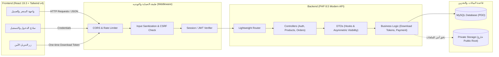

# خطة معمارية وهندسية لمتجر منتجات رقمية (PHP 8.5 + React 19)

> [!IMPORTANT]
> تم تحديث هذه الخطة لتعتمد بالكامل على **PHP 8.5 (بدون إطار عمل Laravel)** للاستفادة القصوى من أحدث إمكانيات اللغة (مثل **Property Hooks**, **Asymmetric Visibility**, والتعامل الأبسط مع الكائنات) مع واجهة **React 19.3** و **TailwindCSS v4**، مع تطبيق صارم لمعايير **OWASP Top 10**.

---

## 1. المعمارية العامة للنظام (Architecture Overview)

يعتمد النظام على نمط **Decoupled Architecture (SPA + Headless REST API)**:
- **الواجهة الأمامية (Frontend):** تطبيق صفحة واحدة (SPA) مبني بـ React 19.3 و TailwindCSS v4 وأداة البناء Vite.
- **الخلفية (Backend):** معمارية خدمات خفيفة (Micro/Clean Architecture) مكتوبة بـ **PHP 8.5** ومُدارة بواسطة Composer، مع الاستفادة من ميزات البرمجة كائنية التوجه الحديثة (DTOs بمحددات رؤية غير متناظرة ومُعالجات الخصائص المدمجة).
- **التواصل:** عبر JSON RESTful APIs مع تبادل ملفات تعريف الارتباط الآمنة (Secure HttpOnly Cookies / SameSite=Strict) أو Tokens مشفرة لمنع تسريب الجلسات وهجمات XSS.



---

## 2. حزمة التقنيات والمكتبات الموصى بها (Tech Stack)

### الخلفية (Backend - PHP 8.5 & MySQL)
1. **PHP Core**: **PHP 8.5**
   - **Asymmetric Visibility (`public private(set)`):** لحماية خصائص النماذج و DTOs من التعديل الخارجي العشوائي دون الحاجة لكتابة Getters تقليدية مملة.
   - **Property Hooks (`get/set`):** لمعالجة وتعقيم البيانات وتأكيد صحتها لحظة إسنادها للخصائص مباشرة داخل الكائنات.
   - **دوال المصفوفات الجديدة (`array_find`, `array_all`, `array_any`):** لكتابة كود تحقق ومطابقة منطقي فائق السرعة والنظافة.
   - **Modern Class Instantiation:** استدعاء الدوال مباشرة دون أقواس إضافية مثل `new Controller()->handle()`.
2. **قاعدة البيانات**: MySQL 8.0+ يتم التعامل معها حصراً عبر **PDO** مع تفعيل `ATTR_EMULATE_PREPARES = false`.
3. **مكتبات Composer الخفيفة والموثوقة:**
   - **الموجّه (Routing):** `bramus/router` أو `nikic/fast-route`.
   - **البيئة والإعدادات (Environment):** `vlucas/phpdotenv`.
   - **التحقق والتسجيل:** `monolog/monolog` لتسجيل أي محاولات اختراق وسجلات الأمان.

### الواجهة الأمامية (Frontend)
1. **React 19.3**: للاستفادة من أحدث خطافات التحكم بالنماذج والتزامن (`useActionState`, `useOptimistic`).
2. **TailwindCSS v4**: أحدث إصدار مع التكوين عبر محرك Vite الجديد `@tailwindcss/vite`.
3. **إدارة الحالة وجلب البيانات:** `@tanstack/react-query` و `zustand`.
4. **أيقونات ومكونات مساعدة:** `lucide-react` و `react-router-dom`.

---

## 3. المخطط الأمني الشامل ضد ثغرات OWASP Top 10

| الثغرة (OWASP Top 10) | آلية الحماية المطبقة في PHP 8.5 |
| :--- | :--- |
| **A01: Broken Access Control** | التحقق الصارم من ملكية المنتجات؛ فحص الرموز المؤقتة وعزل عمليات التنزيل بمسارات مشفرة. |
| **A02: Cryptographic Failures** | استخدام `PASSWORD_ARGON2ID`، وحفظ الملفات خارج مجلد الويب `public/`. |
| **A03: Injection (SQL Injection)** | استخدام Prepared Statements بنسبة 100% عبر PDO مع `ATTR_EMULATE_PREPARES = false`. |
| **A04: Insecure Design & Rate Limiting** | حظر Brute Force بمحدد معدل الطلبات (Rate Limiting) وتتبع محاولات الدخول عبر الـ IP. |
| **A05: Security Misconfiguration** | تعطيل إظهار الأخطاء في الإنتاج، تفعيل ترويسات الأمان (CSP, HSTS, X-Frame-Options). |
| **A06: Vulnerable Components** | التدقيق الدوري لمكتبات Composer و NPM عبر `composer audit`. |
| **A07: Identification & Auth Failures** | تجديد معرف الجلسة فور تسجيل الدخول `session_regenerate_id(true)`، وتطبيق سياسة تعقيد كلمات المرور. |
| **A08: Software & Data Integrity** | التحقق من صحة Webhooks بوابات الدفع بتوقيع رقمي (HMAC Signature Verification). |
| **A09: Security Logging & Monitoring** | تسجيل كل محاولات الدخول الفاشلة والوصول غير المصرح لروابط التنزيل عبر Monolog. |
| **A10: Server-Side Request Forgery (SSRF)** | منع استدعاء أي روابط خارجية من السيرفر مباشرة دون مطابقتها مع قائمة موثوقة (Allowlist). |

---

## 4. تصميم قاعدة البيانات (MySQL Database Schema)

```sql
-- جدول المستخدمين
CREATE TABLE `users` (
    `id` INT UNSIGNED AUTO_INCREMENT PRIMARY KEY,
    `username` VARCHAR(50) NOT NULL UNIQUE,
    `email` VARCHAR(191) NOT NULL UNIQUE,
    `password_hash` VARCHAR(255) NOT NULL,
    `role` ENUM('customer', 'admin') DEFAULT 'customer',
    `created_at` TIMESTAMP DEFAULT CURRENT_TIMESTAMP,
    `updated_at` TIMESTAMP DEFAULT CURRENT_TIMESTAMP ON UPDATE CURRENT_TIMESTAMP,
    INDEX `idx_email` (`email`)
) ENGINE=InnoDB DEFAULT CHARSET=utf8mb4 COLLATE=utf8mb4_unicode_ci;

-- جدول المنتجات الرقمية
CREATE TABLE `products` (
    `id` INT UNSIGNED AUTO_INCREMENT PRIMARY KEY,
    `title` VARCHAR(255) NOT NULL,
    `slug` VARCHAR(255) NOT NULL UNIQUE,
    `description` TEXT NULL,
    `price` DECIMAL(10, 2) NOT NULL,
    `thumbnail_path` VARCHAR(255) NULL,
    `file_path` VARCHAR(500) NOT NULL, -- مسار الملف المحمي في مجلد التخزين الخاص
    `file_size` BIGINT UNSIGNED NOT NULL,
    `is_active` TINYINT(1) DEFAULT 1,
    `created_at` TIMESTAMP DEFAULT CURRENT_TIMESTAMP,
    INDEX `idx_slug` (`slug`),
    INDEX `idx_active` (`is_active`)
) ENGINE=InnoDB DEFAULT CHARSET=utf8mb4 COLLATE=utf8mb4_unicode_ci;

-- جدول الطلبات
CREATE TABLE `orders` (
    `id` INT UNSIGNED AUTO_INCREMENT PRIMARY KEY,
    `order_number` VARCHAR(64) NOT NULL UNIQUE,
    `user_id` INT UNSIGNED NOT NULL,
    `total_amount` DECIMAL(10, 2) NOT NULL,
    `status` ENUM('pending', 'completed', 'cancelled') DEFAULT 'pending',
    `payment_gateway` VARCHAR(50) NULL,
    `payment_id` VARCHAR(191) NULL,
    `created_at` TIMESTAMP DEFAULT CURRENT_TIMESTAMP,
    FOREIGN KEY (`user_id`) REFERENCES `users`(`id`) ON DELETE CASCADE,
    INDEX `idx_user_orders` (`user_id`, `status`)
) ENGINE=InnoDB DEFAULT CHARSET=utf8mb4 COLLATE=utf8mb4_unicode_ci;

-- جدول عناصر الطلب
CREATE TABLE `order_items` (
    `id` INT UNSIGNED AUTO_INCREMENT PRIMARY KEY,
    `order_id` INT UNSIGNED NOT NULL,
    `product_id` INT UNSIGNED NOT NULL,
    `price_at_purchase` DECIMAL(10, 2) NOT NULL,
    FOREIGN KEY (`order_id`) REFERENCES `orders`(`id`) ON DELETE CASCADE,
    FOREIGN KEY (`product_id`) REFERENCES `products`(`id`) ON DELETE RESTRICT
) ENGINE=InnoDB DEFAULT CHARSET=utf8mb4 COLLATE=utf8mb4_unicode_ci;

-- جدول الرموز المؤقتة للتنزيل (Time-limited & Count-limited Download Tokens)
CREATE TABLE `download_tokens` (
    `id` INT UNSIGNED AUTO_INCREMENT PRIMARY KEY,
    `token` VARCHAR(64) NOT NULL UNIQUE,
    `user_id` INT UNSIGNED NOT NULL,
    `product_id` INT UNSIGNED NOT NULL,
    `order_id` INT UNSIGNED NOT NULL,
    `expires_at` DATETIME NOT NULL,
    `downloads_remaining` INT UNSIGNED DEFAULT 5,
    `created_at` TIMESTAMP DEFAULT CURRENT_TIMESTAMP,
    FOREIGN KEY (`user_id`) REFERENCES `users`(`id`) ON DELETE CASCADE,
    FOREIGN KEY (`product_id`) REFERENCES `products`(`id`) ON DELETE CASCADE,
    INDEX `idx_token` (`token`)
) ENGINE=InnoDB DEFAULT CHARSET=utf8mb4 COLLATE=utf8mb4_unicode_ci;
```

---

## 5. نماذج برمجية معمارية بأسلوب PHP 8.5

### ملف `composer.json`
```json
{
    "name": "store/digital-backend",
    "description": "Secure Digital Products Store Backend using PHP 8.5",
    "type": "project",
    "require": {
        "php": "^8.5",
        "bramus/router": "^1.6",
        "vlucas/phpdotenv": "^5.6",
        "monolog/monolog": "^3.7"
    },
    "autoload": {
        "psr-4": {
            "App\\": "src/"
        }
    }
}
```

### كائن نقل البيانات (DTO) بميزات PHP 8.5 (Asymmetric Visibility + Property Hooks)
```php
<?php
namespace App\DTOs;

class UserRegisterDTO {
    // ميزة Asymmetric Visibility: يمكن قراءة الخاصية من أي مكان ولكن لا تعدل إلا داخلياً
    public private(set) string $email;
    
    // ميزة Property Hooks: تنظيف وتحقق تلقائي لحظة الإسناد
    public string $username {
        set {
            $cleaned = trim($value);
            if (strlen($cleaned) < 3) {
                throw new \InvalidArgumentException("اسم المستخدم يجب أن يتجاوز 3 أحرف.");
            }
            $this->username = htmlspecialchars($cleaned, ENT_QUOTES, 'UTF-8');
        }
    }

    public private(set) string $password;

    public function __construct(string $username, string $email, string $password) {
        $this->username = $username;

        if (!filter_var($email, FILTER_VALIDATE_EMAIL)) {
            throw new \InvalidArgumentException("البريد الإلكتروني المدخل غير صالح.");
        }
        $this->email = strtolower(trim($email));

        if (strlen($password) < 8) {
            throw new \InvalidArgumentException("كلمة المرور يجب ألا تقل عن 8 أحرف.");
        }
        $this->password = $password;
    }
}
```

### اتصال PDO الآمن والمحصّن في PHP 8.5 (Database.php)
```php
<?php
namespace App\Config;

use PDO;
use PDOException;

class Database {
    private static ?PDO $instance = null;

    public static function getConnection(): PDO {
        if (self::$instance === null) {
            $host = $_ENV['DB_HOST'] ?? '127.0.0.1';
            $db   = $_ENV['DB_DATABASE'] ?? 'digital_store';
            $user = $_ENV['DB_USERNAME'] ?? 'root';
            $pass = $_ENV['DB_PASSWORD'] ?? '';
            $port = $_ENV['DB_PORT'] ?? '3306';

            $dsn = "mysql:host=$host;port=$port;dbname=$db;charset=utf8mb4";
            $options = [
                PDO::ATTR_ERRMODE            => PDO::ERRMODE_EXCEPTION,
                PDO::ATTR_DEFAULT_FETCH_MODE => PDO::FETCH_ASSOC,
                // منع التجهيز المزيف لضمان عدم تمرير أي كود خبيث في SQL Injection
                PDO::ATTR_EMULATE_PREPARES   => false,
            ];

            try {
                self::$instance = new PDO($dsn, $user, $pass, $options);
            } catch (PDOException $e) {
                error_log("Database Connection Error: " . $e->getMessage());
                throw new \Exception("تعذر الاتصال بقاعدة البيانات بشكل آمن.");
            }
        }
        return self::$instance;
    }
}
```

### التحكم بالتسجيل والدخول مع استغلال دوال PHP 8.5 (AuthController.php)
```php
<?php
namespace App\Controllers;

use App\Config\Database;
use App\DTOs\UserRegisterDTO;
use App\Utils\Response;
use PDO;

class AuthController {
    public function register(): void {
        $input = json_decode(file_get_contents('php://input'), true) ?? [];

        // التأكد من وجود كافة الحقول المطلوبة باستخدام دالة array_all في PHP الحديثة
        $requiredFields = ['username', 'email', 'password'];
        $hasAllFields = array_all($requiredFields, fn($field) => !empty($input[$field]));

        if (!$hasAllFields) {
            Response::json(['error' => 'جميع الحقول مطلوبة.'], 422);
            return;
        }

        try {
            // الاستفادة من الـ DTO المجهز بـ Property Hooks للتحقق التلقائي
            $dto = new UserRegisterDTO($input['username'], $input['email'], $input['password']);
        } catch (\InvalidArgumentException $e) {
            Response::json(['error' => $e->getMessage()], 422);
            return;
        }

        $passwordHash = password_hash($dto->password, PASSWORD_ARGON2ID);
        $pdo = Database::getConnection();

        $stmt = $pdo->prepare("SELECT id FROM users WHERE email = :email OR username = :username LIMIT 1");
        $stmt->execute(['email' => $dto->email, 'username' => $dto->username]);
        if ($stmt->fetch()) {
            Response::json(['error' => 'البريد الإلكتروني أو اسم المستخدم قيد الاستخدام'], 409);
            return;
        }

        $insert = $pdo->prepare("INSERT INTO users (username, email, password_hash) VALUES (:username, :email, :pass)");
        $insert->execute([
            'username' => $dto->username,
            'email'    => $dto->email,
            'pass'     => $passwordHash
        ]);

        Response::json(['message' => 'تم إنشاء الحساب بنجاح'], 201);
    }
}
```

### نظام تدفق وتحميل الملفات الآمن (DownloadController.php)
```php
<?php
namespace App\Controllers;

use App\Config\Database;
use App\Utils\Response;
use PDO;

class DownloadController {
    public function download(string $token): void {
        $pdo = Database::getConnection();

        // 1. التحقق من صلاحية الرمز والوقت وعدد التنزيلات المتبقية
        $stmt = $pdo->prepare("
            SELECT dt.id, dt.downloads_remaining, dt.expires_at, p.file_path, p.title 
            FROM download_tokens dt
            JOIN products p ON dt.product_id = p.id
            WHERE dt.token = :token AND dt.expires_at > NOW() AND dt.downloads_remaining > 0
            LIMIT 1
        ");
        $stmt->execute(['token' => $token]);
        $record = $stmt->fetch();

        if (!$record) {
            Response::json(['error' => 'رابط التنزيل غير صالح أو منتهي الصلاحية'], 403);
            return;
        }

        $fullPath = realpath(__DIR__ . '/../../storage/' . $record['file_path']);
        $storageDir = realpath(__DIR__ . '/../../storage/digital_assets');

        // حماية مسار الملف ضد ثغرة Directory / Path Traversal
        if (!$fullPath || !str_starts_with($fullPath, $storageDir) || !file_exists($fullPath)) {
            Response::json(['error' => 'الملف المطلوب غير موجود على الخادم'], 404);
            return;
        }

        // 2. تقليص عدد التنزيلات المتبقية
        $update = $pdo->prepare("UPDATE download_tokens SET downloads_remaining = downloads_remaining - 1 WHERE id = :id");
        $update->execute(['id' => $record['id']]);

        // 3. إرسال الترويسات ودفق الملف بأمان
        $fileName = basename($fullPath);
        header('Content-Description: File Transfer');
        header('Content-Type: application/octet-stream');
        header('Content-Disposition: attachment; filename="' . addslashes($record['title']) . '_' . $fileName . '"');
        header('Expires: 0');
        header('Cache-Control: must-revalidate');
        header('Pragma: public');
        header('Content-Length: ' . filesize($fullPath));

        if (ob_get_level()) {
            ob_end_clean();
        }
        readfile($fullPath);
        exit;
    }
}
```

---

## 6. إعداد واجهة React 19.3 و TailwindCSS v4

### ملف `vite.config.js`
```javascript
import { defineConfig } from 'vite';
import react from '@vitejs/plugin-react';
import tailwindcss from '@tailwindcss/vite';

export default defineConfig({
  plugins: [
    react(),
    tailwindcss(),
  ],
  server: {
    port: 3000,
    proxy: {
      '/api': {
        target: 'http://localhost:8000',
        changeOrigin: true,
      },
    },
  },
});
```

### ملف `frontend/src/app.css` (TailwindCSS v4)
```css
@import "tailwindcss";

@layer base {
  body {
    @apply bg-slate-950 text-slate-100 min-h-screen font-sans;
    direction: rtl;
  }
}
```

---

## 7. الخطوات التنفيذية المحدثة

1. **تهيئة بيئة Backend بـ PHP 8.5:** ضبط ملف `composer.json` بالاعتماد على `"php": "^8.5"` وتثبيت المكونات الأساسية.
2. **بناء فئات الـ DTOs:** استخدام **Property Hooks** و **Asymmetric Visibility** لضمان نظافة المدخلات ومنع تعديلها غير المصرح.
3. **تهيئة جداول قاعدة البيانات بـ MySQL:** تنفيذ استعلامات الـ Schema الموضحة في القسم 4.
4. **تطوير واجهة React 19.3 + TailwindCSS v4:** بناء واجهات المتجر ونظام التحميل.
5. **الفحص والتدقيق الأمني:** التحقق من مناعة النظام ضد هجمات OWASP Top 10.
